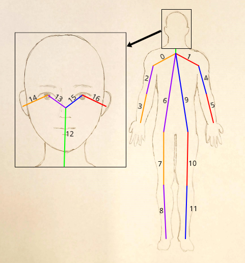

# Notes on Pose Estimation

When working with the depthAI system for pose estimation, there are key details about the packet passed to the callback function. See below for a template of how to work with the callback function.

```python

def callback(packet):
    # Work with the packet here

with OakCamera() as oak:
    color = oak.create_camera('color')
    human_pose_nn = oak.create_nn('human-pose-estimation-0001', color)
    # To manipulate the frame + data
    oak.visualize(human_pose_nn, callback=callback)
    # To just visualize the frame
    oak.visualize(human_pose_nn)
    oak.start(blocking=True)
```

the packet passed to the callback function has a few notable properties:

- `packet.landmarks.landmarks` has a list of landmarks in some nested lists. The format of these, at the appropriately inner level (print it out to understand this), is

```json
[
    [
        [x1, y1],
        [x2, y2]
    ],
    [
        [x1, y1],
        [x2, y2]
    ],
    ...
]
```

Each pair of points corresponds to the points forming the lines in the skeletized frame of the person detected (for visual, see [docs](https://docs.luxonis.com/projects/sdk/en/latest/samples/NNComponent/sdk_human_pose/)). These points range from 0 to 1 and are relative to the frame size.

- `packet.landmarks.landmarks_indices` has a list of IDs corresponding to each pair of points in the `landmarks` list. This is useful for determining which points correspond to which body parts. These labels, from manual testing, are drawn below:


credit to Joselyn Xa-Chin for the base drawing
